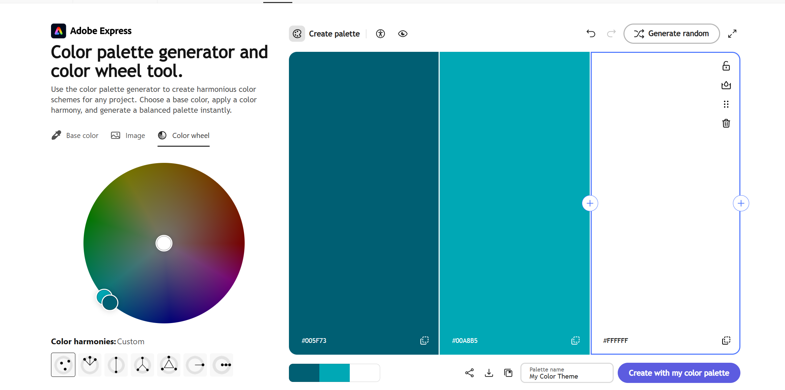

# Portfolio-Assignment
Mehran Ahmed-Al Personal Portfolio

This is my portfolio website Assignment 1. I used HTML5 and CSS3 to show my video editing and graphic design work. It has four pages: Home, About Me, My Projects and Contact.

Website Links:

https://mehranal77.github.io/Portfolio-Assignment/

https://github.com/MehranAl77/Portfolio-Assignment

Responsive Design:

I used three separate CSS files with media queries to adjust the layout for different screen sizes, even though I know you could put it all in one file but this seemed more organised and easier for me (less messy).

mobile.css: 600px and below.
tablet.css: 601px to 1024px.
laptop.css: 1025px and above.

I chose these sizes so the website is easier to use on phones, tablets and laptops. The style.css file contains the main design for all screen sizes. I did not use Flexbox or Grid. I used Chrome

Gradients:
I used a regular linear gradient in the header, going from #005F73 to #00A8B5. I also used a 45 degree angled linear gradient in the footer with the same colours.

Colour Scheme

I used a cyan and white colour scheme with a dark cyan (#005F73), bright cyan (#00A8B5) and white (#FFFFFF). I chose these colours to keep the website simple and consistent. It was also heavily inspired by the colours I saw my TA use for his website when he showed it in his tutorial. Dark cyan is used for the navigation and text, bright cyan is used in the gradients and borders, and white is used for backgrounds and text on darker areas. I also entered my website colours into Adobe Color to show the colour scheme I used, I put a screenshot below

The Tests:
W3C HTML Validator: All four HTML pages checked with no errors.
W3C CSS Validator: CSS files checked with no errors.
W3C Link Checker: Live website links checked.
WAVE: Homepage checked with 0 errors, 0 contrast errors and 0 alerts.
Responsive Testing: Checked at mobile, tablet and laptop screen sizes.

External Code Sources
I mainly used the HTML and CSS concepts covered in the lectures. If I'm being honest, I did not know we were allowed to take code from external sites which is why I avoided it, must have missed the part that said we were allowed.